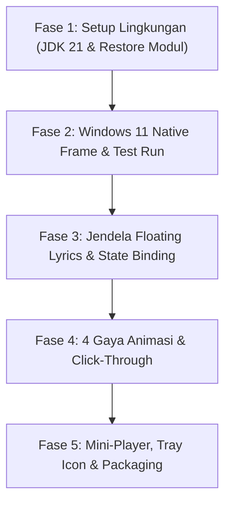

# Blueprint & Rencana Eksekusi: BitChord Windows Edition & Floating Desktop Lyrics

Dokumen ini adalah rencana acuan utama (*single source of truth*) untuk membangun, menyesuaikan, dan memodernisasi klien musik BitChord khusus untuk sistem operasi **Windows 11**. Fokus utama proyek ini adalah mengembalikan versi desktop, membuang elemen antarmuka macOS, mengintegrasikan kontrol jendela native Windows 11, serta menambahkan fitur **Floating Desktop Lyrics (Lirik Mengambang / Pop-up)** yang ramah produktivitas (*multitasking-friendly*).

---

## 1. Analisis Masalah & Kebutuhan Utama

Berdasarkan pengujian pada versi desktop BitChord saat ini:
1. **Antarmuka Bergaya macOS (Kurang Cocok di Windows):**
   - Jendela aplikasi masih menggambar tombol kontrol jendela *traffic light* khas Mac (merah, kuning, hijau) di pojok kiri atas via `MacCaptionButton`.
   - Tidak ada integrasi tombol kontrol Windows 11 (Minimize, Maximize/Restore, Close) di pojok kanan atas.
2. **Lirik Fullscreen Takeover (Menghambat Kerja):**
   - Tampilan *Now Playing* saat ini mengambil alih seluruh layar monitor. Ketika pengguna sedang bekerja (koding di Antigravity IDE / VS Code, desain di Blender, browsing, menulis dokumen), layar penuh tertutup sehingga pengguna tidak bisa menikmati lirik sambil beraktivitas.
3. **Solusi yang Dibangun:**
   - **Floating Desktop Lyrics Window:** Jendela kedua yang independen, melayang di atas semua aplikasi (*Always-on-Top*), transparan, dengan animasi kemunculan lirik dinamis.
   - **Mini-Player Mode:** Mode ringkas di pojok layar dengan navigasi dasar lagu.
   - **System Tray:** Aplikasi bisa diminimize ke area notifikasi taskbar Windows agar tidak memenuhi taskbar kerja.

---

## 2. Keputusan Arsitektur & Lingkungan Pengembangan (Development Stack)

### A. Runtime & Toolchain: Mengapa Wajib JDK 21?
* **Java Development Kit (JDK 21):**
  - Modul desktop BitChord (`desktopApp/build.gradle.kts`) secara eksplisit mengunci target toolchain ke Java 21:
    ```kotlin
    kotlin { compilerOptions { jvmTarget.set(JvmTarget.JVM_21) } }
    java { toolchain { languageVersion.set(JavaLanguageVersion.of(21)) } }
    ```
  - **Mengapa bukan JDK 17?** Gradle akan menolak kompilasi jika JDK yang terpasang hanya versi 17 karena requirement toolchain versi 21. Sebaliknya, JDK 21 sepenuhnya *backward compatible* (bisa mengompilasi modul shared/Android bertarget Java 17).
  - **Paket Resmi:** `EclipseAdoptium.Temurin.21.JDK` via Windows Package Manager (`winget`).

### B. IDE & Editor: Antigravity IDE (Tidak Perlu Android Studio)
* **Antigravity IDE** (berbasis VS Code) adalah lingkungan kerja utama:
  - **Antigravity Tab:** Menyediakan AI autocomplete cerdas, prediksi import otomatis, dan supercomplete di file Kotlin/Compose.
  - **Inline Refactor (<kbd>Ctrl</kbd> + <kbd>I</kbd>):** Generator dan modifikator kode di baris aktif.
  - **Peek Definition (<kbd>Alt</kbd> + <kbd>F12</kbd>):** Melihat implementasi fungsi dan snippet tanpa pindah tab.
* **Tanpa Android Studio:** Modul desktop berjalan langsung di atas JVM Windows (`./gradlew :desktopApp:run`). Android SDK tidak diperlukan, sehingga menghemat ruang disk dan RAM 4–8 GB.

---

## 3. Penanganan Autentikasi YouTube Music di Desktop

BitChord di desktop telah memiliki dua mesin penangkap autentikasi yang sangat andal di dalam kode sumbernya:

```
[Pengguna di Windows]
        |
        +---> Opsi A: In-App WebView (DesktopWebSignIn.kt)
        |     - Membuka dialog login accounts.google.com
        |     - Otomatis menangkap cookie SAPISID saat diarahkan ke music.youtube.com
        |
        +---> Opsi B: Browser Cookie Sync (DesktopBrowserCookies.kt)
              - Mendeteksi profil Google Chrome, Edge, Brave, dan Firefox di Windows
              - Membaca database SQLite cookies lokal (%LOCALAPPDATA% / DPAPI Windows)
              - Pengguna langsung login otomatis tanpa perlu mengetik ulang kata sandi!
```

---

## 4. Arsitektur Jendela Mengambang (Floating Desktop Lyrics)

### A. Struktur Multi-Window Compose Desktop
Compose Multiplatform mendukung banyak jendela berjalan serentak dalam satu lifecycle aplikasi:

```kotlin
// Jendela Kedua Khusus Lirik (Floating Overlay)
if (isFloatingLyricsEnabled) {
    Window(
        onCloseRequest = { isFloatingLyricsEnabled = false },
        state = rememberWindowState(
            position = WindowPosition(savedX.dp, savedY.dp),
            size = DpSize(650.dp, 100.dp)
        ),
        alwaysOnTop = true,        // Tetap melayang di atas IDE/Browser
        undecorated = true,        // Tanpa frame/border OS yang kaku
        transparent = true         // Latar belakang transparan
    ) {
        FloatingLyricsView(
            currentLine = playbackState.currentLine,
            nextLine = playbackState.nextLine,
            progressMs = lyricClock.currentOffsetMs,
            animationStyle = userSelectedStyle
        )
    }
}
```

### B. 4 Preset Gaya Animasi Lirik (Lyrics Entrance & Transition Styles)
1. **Gaya Ping-Pong Slide (Kiri & Kanan Bergantian):**
   - Baris ganjil meluncur masuk dari sisi kiri (`slideInHorizontally { -it } + fadeIn()`).
   - Baris genap meluncur masuk dari sisi kanan (`slideInHorizontally { it } + fadeIn()`).
   - Baris yang selesai memudar keluar ke arah berlawanan.
2. **Gaya Dynamic Capsule Pop (Muncul dari Atas Layar):**
   - Menempel di bagian tengah atas layar (seperti Dynamic Island / HUD).
   - Teks baru meluncur turun dari atas (`slideInVertically { -it / 2 } + fadeIn() + spring()`).
3. **Gaya Karaoke Gradient Sweep (Syllable-Level Highlight):**
   - Teks lirik ditampilkan redup (transparan 35%), lalu warna aksen terang menyapu per suku kata seiring vokal dinyanyikan.
4. **Gaya Ambient Ghost (Zero-Distraction untuk Koding):**
   - Teks putih tipis berbayang halus tanpa kotak background, melayang di sudut layar.
   - Pergantian lirik menggunakan *smooth vertical float* (naik 8px) + *crossfade*.
   - Dilengkapi toggle *Click-Through* (Win32 `WS_EX_TRANSPARENT`) agar klik mouse tembus ke aplikasi di bawahnya.

---

## 5. Roadmap & Tahapan Eksekusi



### Rincian Checklist:

#### Fase 1: Setup Lingkungan & Restore Modul Desktop
- [x] Install JDK 21 via `winget install EclipseAdoptium.Temurin.21.JDK`.
- [x] Verifikasi ketersediaan perintah `java -version` dan `javac -version`.
- [x] Restore folder `desktopApp` dan `desktopUi` dari riwayat commit git `e4dd63d8^1`.
- [x] Daftarkan kembali `include(":desktopApp")` di [settings.gradle.kts](file:///c:/Users/Daffa/Desktop/Folder Space AI/Folder Space Semester 7/Bit Chord/settings.gradle.kts).

#### Fase 2: Native Windows 11 Window Chrome & Smoke Test
- [x] Hapus pemanggilan `MacCaptionButton` (lampu merah-kuning-hijau) di `desktopApp/.../DesktopWindowChrome.kt`.
- [x] Pasang kontrol jendela Windows 11 (Minimize, Maximize, Close) di pojok kanan atas dengan styling Fluent / hover effects.
- [x] Jalankan `./gradlew :desktopApp:run` dan pastikan jendela utama terbuka normal di Windows 11.
- [x] Nonaktifkan notifikasi popup update mengganggu dari upstream.

#### Fase 3: Pembuatan Jendela Floating Lyrics (Overlay)
- [x] Buat file baru `FloatingLyricsWindow.kt` dengan parameter `alwaysOnTop = true`, `undecorated = true`, `transparent = true`.
- [x] Sambungkan *state* lirik aktif dari `PlaybackService` dan `LyricClock` ke komponen floating.
- [x] Implementasikan fitur *draggable window* (bisa digeser ke mana saja).

#### Fase 4: Dynamic Island Lyrics & YouTube Music Session Persistence (Selesai!)
- [x] **Dynamic Island Lyrics Window (Format 3 Baris Lirik + Media Control)**:
  - Format Kapsul Mengambang Dynamic Island (`660.dp x 104.dp`) dengan deep OLED glass background & border glowing halus.
  - **Kiri**: Artwork Cover, Judul Lagu, Artis, dan Kontrol Pemutar Musik (`⏮ Prev`, `▶/⏸ Play/Pause/Stop`, `⏭ Next/Lanjut`, `🔁 Repeat Mode`).
  - **Kanan (3 Baris Lirik Rolling)**:
    - Baris 1: `(Lirik Lagu Sebelum)` — teks redup 38%
    - Baris 2: `(Lirik Lagu Sekarang)` — teks aktif bold menyala 100% dengan animasi transisi bergulir
    - Baris 3: `(Lirik Lagu Sesudah)` — teks redup 38%
  - Hover Action Badges: Pin/Lock toggle & Close button.
- [x] **Ingat Sesi Login YouTube Music Permanen**:
  - Menyimpan cookie dan identitas sesi ke `DesktopPersistence` dan backup file lokal di `~/.bitchord/`.
  - Mengaktifkan auto-restore sesi saat aplikasi diluncurkan di `DesktopApp.kt` dan `DesktopAccounts.kt`.

#### Fase 5: Mini-Player, System Tray & Distribusi
- [ ] Aktifkan `DesktopAwtTray.kt` agar aplikasi bisa bersembunyi di System Tray Windows saat di-minimize.
- [ ] Tambahkan toggle *Click-Through Mode* (`WS_EX_TRANSPARENT`) via JNI jika diinginkan.
- [ ] Paketkan menjadi installer Windows (`.msi` / executable mandiri) via Gradle task `packageMsi` / `packageDistributionForCurrentOS`.
